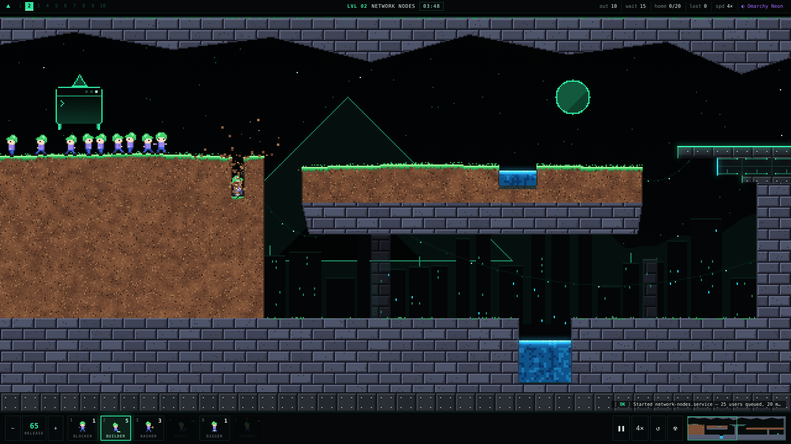

# Omarchy Lemmings

> **Think ahead. Save them all.** A Lemmings tribute set in the Omarchy world.
> An unfinished, novice-led project. One fully designed sample level so far; help is welcome.

Omarchy Lemmings is a small browser puzzle game in the spirit of the classic
Lemmings games. Cute green-haired lemmings tumble out of a hatch into stark
Omarchy architecture: near-black caverns, riveted metal with neon edges,
circuit-panel nodes and a glowing triangle gate. Your job is to hand out a
small budget of tools so enough of them make it home.



## What's here (v0.2)

- **A rebuilt engine** with pixel-level terrain: digging, bashing, mining and
  building remove or add individual pixels, as in the originals.
- **Deterministic physics and replays.** Every recorded solution is re-verified
  headlessly with `node tools/verify.js`.
- **Six classic skills:** Blocker, Builder, Basher, Miner, Digger, Bomber.
  Materials: dirt, rock, metal, tech, one-way walls, lava and coolant.
- **LVL 02 · NETWORK NODES:** a sample level with three verified routes
  (upper bridge network, lower service tunnel, hybrid drop). It needs crowd
  control, and a random search of 60,000 plans found no shortcut. Its design
  record is in [`docs/levels/02-network-nodes.md`](docs/levels/02-network-nodes.md).
- **Pixel art and synth audio made in code.** There are no image or audio files.
- **Omarchy flavour:** a Waybar-style top bar (campaign slots as workspaces), a
  launcher-style level select with fuzzy search, nine theme palettes (each
  level brings its own; override from THEMES), a `journalctl`-style event log
  (`L`), and a fastfetch-style results screen.
- **Hazard Lab:** a playground for the OOM-killer press and sliding-window
  platforms (retracting bridge + lift), with a verified solution.
- **Debug and design tools:** material view, state labels, zones and a splat
  ruler, single-step, in-place level reload, test lemmings, replay copy and
  playback.

The other nine campaign slots are planned in
[`omarchy_lemmings_agent_pack/AGENTS.md`](omarchy_lemmings_agent_pack/AGENTS.md)
and appear as "not built yet" in level select. The original prototype is kept,
playable, in [`legacy/`](legacy/).

## Play

```sh
omarchy-launch-webapp "file://$PWD/index.html"
```

or click the `λ` button in the Omarchy bar once the plugin is enabled.

| Key | Action |
|---|---|
| `1`–`6` / click | pick a skill, then click a lemming |
| `Space` | pause (you can still assign while paused) |
| `F` | speed 1× / 2× / 4× |
| `+` / `−` | release rate |
| `R` | restart |
| `N N` | nuke |
| arrows · screen edge · right-drag · minimap | scroll |
| `Z` / `X` | zoom out / in |
| `M` / `B` | sound / music |
| `L` | journal log on / off |
| `H` | help |
| `` ` `` | debug tools |

A Blocker can be given a new job (Builder, Basher, Miner or Digger). That's how
you release a crowd you're holding back.

## Install as an Omarchy plugin

```sh
omarchy plugin add https://github.com/YOUR-USERNAME/omarchy-lemmings.git --enable
```

The plugin adds a `λ` button to the bar that opens the local game as a web app.
It installs no packages, uses no sudo, runs no service and makes no network
requests.

## Develop

```sh
node tools/verify.js        # every recorded solution still wins
node tools/solve-02.js      # scripted LVL 02 solutions (add --write to record them)
node tools/solve-lab.js     # scripted Hazard Lab solution
node tools/shortcuts-02.js  # lazy-strategy probes (add --random N for a random search)
node tools/tolerance-02.js  # how forgiving each key decision is
```

- [`docs/ENGINE.md`](docs/ENGINE.md): file map, physics constants, skills,
  replays and tools.
- [`docs/LEVEL_FORMAT.md`](docs/LEVEL_FORMAT.md): how to write a level and the
  workflow for proving it.

## Help wanted

Level design, sprite animation, music, Quickshell packaging, accessibility,
and testing on different screen sizes. Please explain changes gently and
include reproduction steps for bugs.

## License and scope

MIT. This is an unofficial tribute and is not affiliated with the owners of
the Lemmings name or the original game. All visuals and audio are generated
procedurally by this code; no original assets are used.
