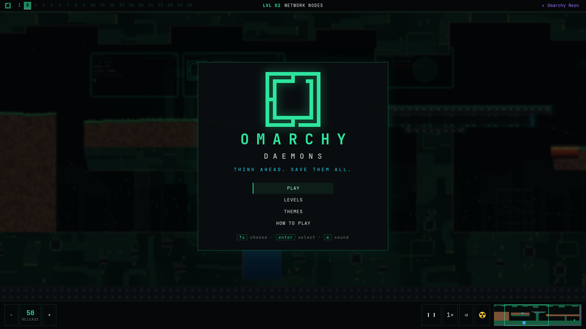
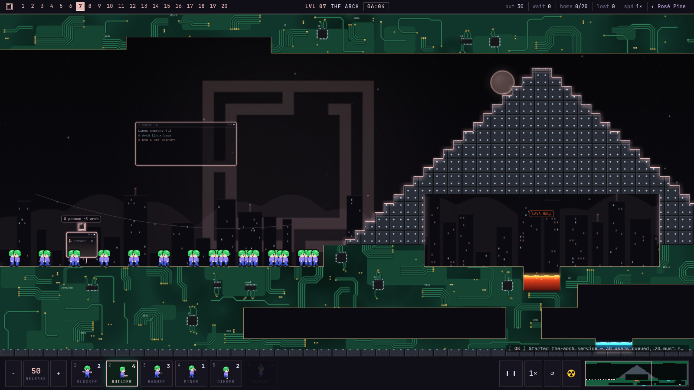
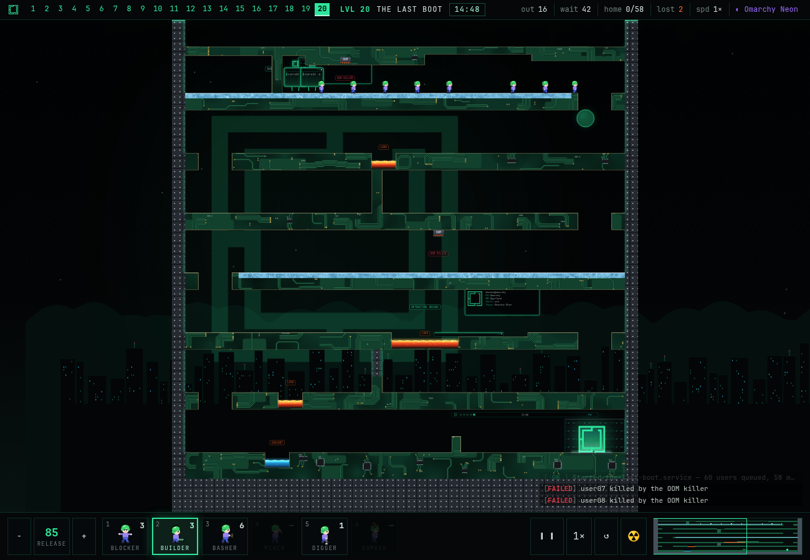
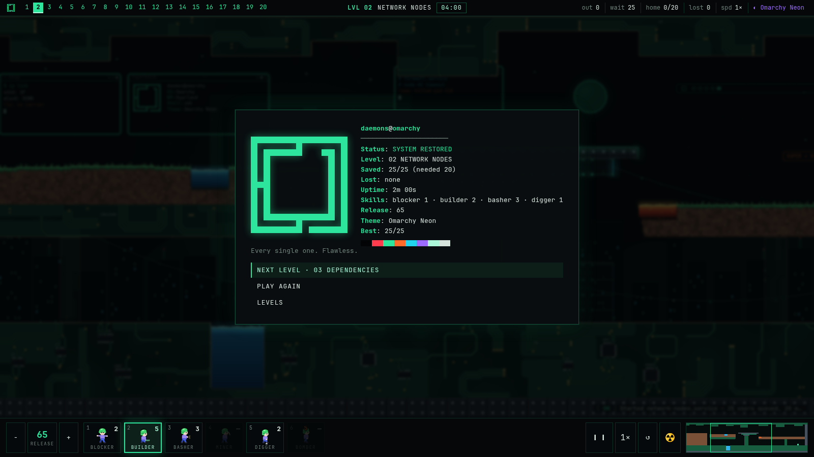

# Omarchy Daemons

> **Think ahead. Save them all.** A crowd-guiding puzzle game for the Omarchy desktop.

Tiny green-haired daemons tumble out of a hatch into stark Omarchy architecture:
near-black caverns, riveted metal with neon edges, circuit-board rock and a
glowing Omarchy-logo gate. You can't steer them, only hand out a small budget
of tools (build, bash, dig, mine, block, bomb) so enough of them make it home.

It is a single web page: no build step, no dependencies, no network access,
and every image and sound is generated in code.





## Install (Omarchy)

```sh
omarchy plugin add https://github.com/s3pp3ku/omarchy-daemons.git --enable
```

That puts a `λ` button on your bar that opens the game as a web app. The plugin
installs no packages, runs no service, uses no sudo and makes no network
requests. Update it later with `omarchy plugin update`.

Prefer the menu? Add an entry to `~/.config/omarchy/extensions/omarchy-menu.jsonc`:

```jsonc
"games.daemons": {
  "icon": "", "label": "Omarchy Daemons",
  "action": "omarchy-launch-webapp file:///home/YOU/.config/omarchy/plugins/io.github.s3pp3ku.omarchy-daemons/index.html",
  "description": "Guide a crowd of daemons to the Omarchy gate", "aliases": ["daemons"]
}
```

### Remove

```sh
omarchy plugin remove io.github.s3pp3ku.omarchy-daemons
```

Your progress lives in the app's browser storage, not in the plugin folder, and
the plugin never touches your other configuration. If you added the menu entry
above, delete it from `omarchy-menu.jsonc` too.

### Requirements

Omarchy with the shell plugin system and Chromium (the default). Nothing else:
no packages, no services, no network.

### Without Omarchy

Open `index.html` in any Chromium-based browser (`chromium --app=file://$PWD/index.html`
works well). Progress is stored in the browser's local storage.

## The campaign

Twenty levels, **played in order**: a level unlocks when you complete the one
before it. Every level has at least one verified solution and a design record in
[`docs/levels/`](docs/levels/). Difficulty climbs through six tiers:

| Tier | Levels | What changes |
|---|---|---|
| ROOKIE | 01 BOOT SEQUENCE · 02 NETWORK NODES · 03 DEPENDENCIES | bridges, tunnels, a second hatch and a one-way door |
| USER | 04 PACKAGE CACHE · 05 FIREWALL · 06 VERTICAL WORLD | stacked layers, ports and plugs, floors you can skip by digging |
| POWER USER | 07 THE ARCH · 08 AUR VALLEY · 09 ICE CAVERNS · 10 THE OMARCH | the stepped A-frame, an OOM press, ice that doubles your speed, the kernel |
| SYSADMIN | 11 SYSTEMD · 12 SEGFAULT · 13 DEADLOCK · 14 RACE CONDITION | 90%+ quotas: guard pits, gate presses, break a deadlock with a bomb, cross on a bridge's beat |
| ARCHITECT | 15 MEMORY LEAK · 16 FORK BOMB · 17 ZERO DAY · 18 KERNEL PANIC | scout a whole tower, guard a stream of 64, spend bombs |
| ROOT | 19 ROOT ACCESS · 20 THE LAST BOOT | diagonal miner ramps, then everything at once |

There is also a **Hazard Lab** (OOM press, sliding windows) for trying mechanics.

## Playing

| Key | Action |
|---|---|
| `1`-`6` / click | pick a skill, then click a daemon |
| `Space` | pause (you can still assign while paused) |
| `F` | speed 1× / 2× / 4× |
| `+` / `-` | release rate (you can only raise it) |
| `R` | restart · `N N` nuke |
| arrows / wasd · wheel or two-finger scroll · shift+wheel · screen edge · right-drag · minimap | pan |
| `Z` / `X` · ctrl+wheel · pinch | zoom out / in |
| `0` / `Home` | zoom to fit and recentre |
| `G` | skill preview (a ghost of what a skill will do) |
| `L` | journal log · `M` / `B` sound / music · `H` help |

Tips: a **Blocker** can be handed a new job (Builder, Basher, Miner, Digger):
that is how you release a held crowd. A **Basher** can be picked long before
the wall; it walks there and starts. A bridge is one-way: a crowd turned back
by a blocker walks off its end.

## How it works

- **Pixel terrain.** Digging, bashing, mining and building add and remove
  individual pixels; terrain is drawn smooth at up to 4× detail.
- **Deterministic physics and replays.** Every recorded solution is replayed
  headlessly by `node tools/verify.js` under exactly the browser's physics.
- **Omarchy flavour.** A Waybar-style top bar (levels are workspaces), a
  launcher-style level select with fuzzy search, nine theme palettes (each level
  brings its own), a `journalctl`-style event log and a fastfetch-style results
  screen.



## Develop

Needs only Node.js for the tools.

```sh
node tools/verify.js              # every recorded solution still wins
node tools/solve.js 07            # replay level 07's scripted solutions (--write to record)
node tools/table.js               # quota, rate, tools and results for every level
node tools/random.js the-arch N   # random search for unintended shortcuts
node tools/ascii.js the-arch      # ASCII view of a level
node tools/mk/12-segfault.js      # regenerate a level (11-20 are generated; see tools/mk/lib.js)
omarchy plugin validate .         # check the manifest
```

- [`docs/ENGINE.md`](docs/ENGINE.md): file map, physics constants, skills, tools.
- [`docs/LEVEL_FORMAT.md`](docs/LEVEL_FORMAT.md): how to write a level and prove it.
- [`docs/DESIGN_BRIEF.md`](docs/DESIGN_BRIEF.md): the design pillars behind the campaign.
- [`CONTRIBUTING.md`](CONTRIBUTING.md): how to help.

## License

MIT, see [LICENSE](LICENSE). This is an independent fan project for the Omarchy
community and is not affiliated with or endorsed by Omarchy's authors. The name
Omarchy and the Omarchy logo belong to their owners; the logo is used here to
theme an Omarchy plugin. All other visuals and audio are generated by this
project's code; no third-party game assets are used.
